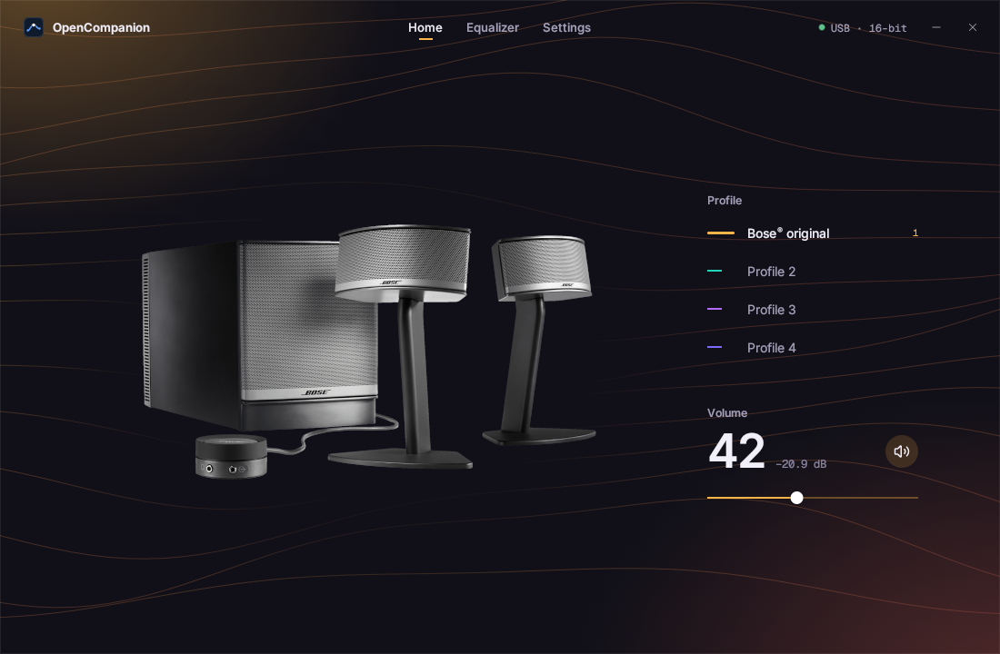
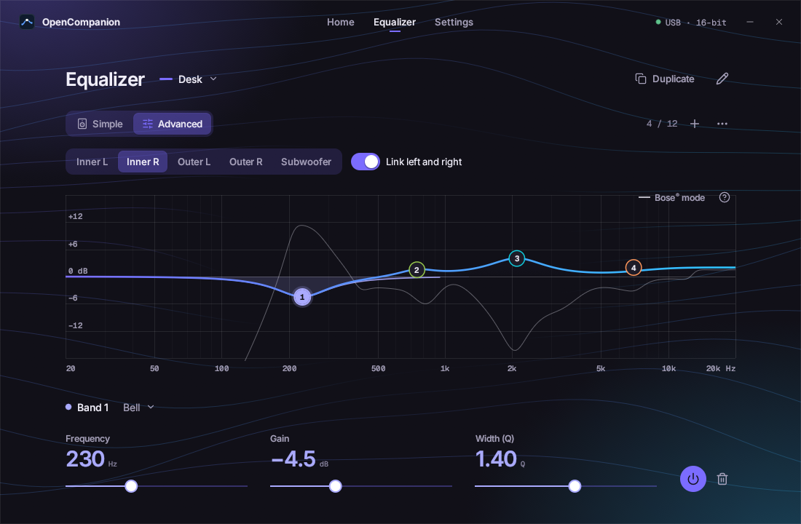
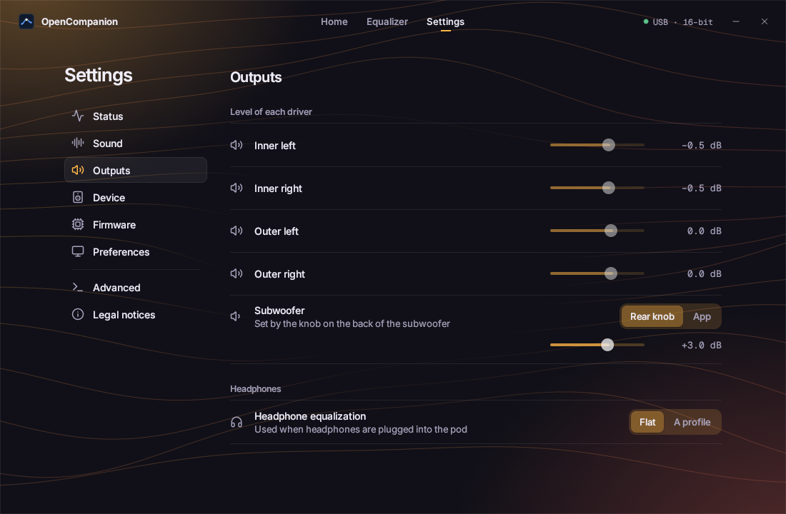
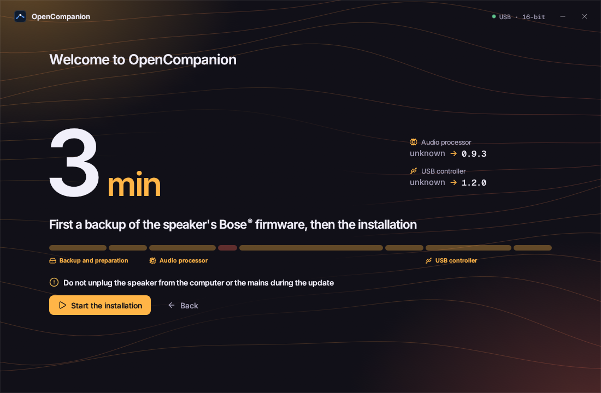

# OpenCompanion

**Open firmware and app for the Bose® Companion® 5: EQ profiles, volume and mute synced with your computer, no drivers.**

## What you get over the stock firmware

| | Stock Bose firmware | OpenCompanion |
|---|---|---|
| Volume knob and mute button | speaker only | synced live with the computer's volume and mute, both ways |
| Knob all the way down | lowest volume | real mute |
| Equalizer | fixed | 4 profiles, **Simple** (all speakers) or **Advanced** (each driver) |
| Switching profiles | no profiles | from the app, or double-tap the pod's mute button; no clicks |
| Original sound | the only sound | kept as the locked **Bose original** profile |
| Subwoofer level | rear knob | rear knob, or set in the app |
| USB audio | 5.1, 16-bit | 5.1 16-bit, or 2.1 24-bit |
| Updates | none | from the app (firmware from this project's GitHub releases) |
| Safety net | none | automatic backup of the Bose firmware, restore in a few clicks |

Works on Windows, macOS and Linux.

  
  

## Get started

1. **Download** the app for your system from [Releases](../../releases).
2. **Open it** with the speaker plugged into the computer and the mains.
3. **Follow the guided install.** It backs up the original Bose firmware first; you can restore it anytime.

> **Unsigned builds.** Windows and macOS warn the first time you open the app. That's expected:
> [how to open it](docs/install.md#first-launch-unsigned-builds).

## Docs

- [Install the app](docs/install.md) · [First setup](docs/first-setup.md) · [Back to Bose](docs/restore.md)
- [Troubleshooting](docs/troubleshooting.md) · [FAQ](docs/faq.md) · [Recovery (advanced)](docs/recovery.md)
- [All docs](docs/README.md) · [Developers](docs/developer/README.md)

## Licence

GPL-3.0-or-later, see [LICENSE](LICENSE). Third-party licences: [licenses/](licenses/).
Copyright © the OpenCompanion contributors. Installing an unofficial firmware is at your own risk
([legal notices](docs/legal.md)).

Bose and Companion are trademarks of Bose Corporation. OpenCompanion is an independent project, not affiliated with or endorsed by Bose.
