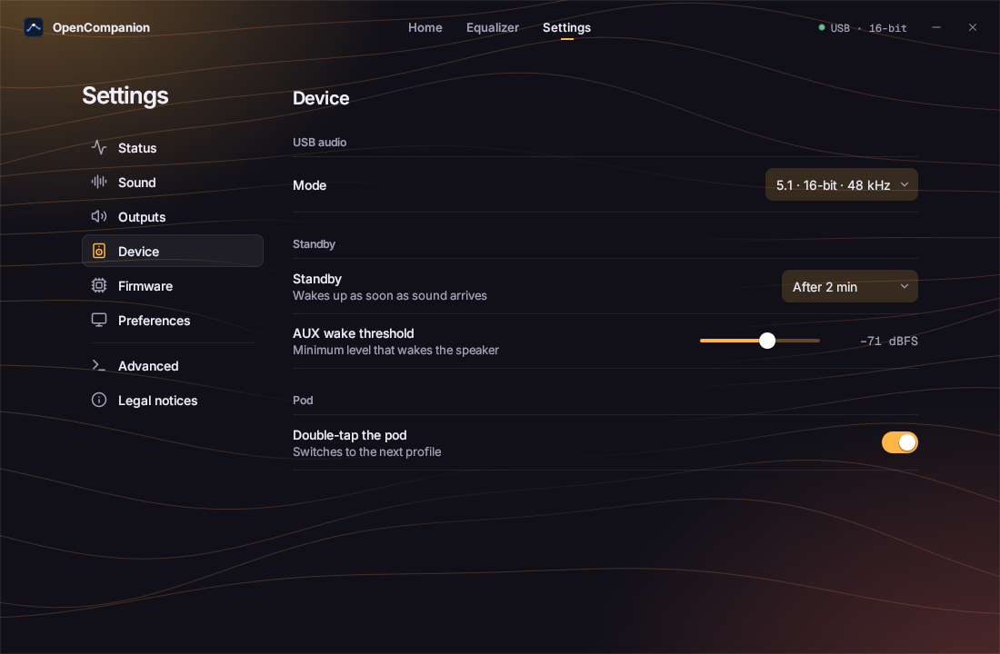

# FAQ

## Do I need the app all the time?

No. The speaker works on its own as a standard USB audio device. The app is for installing, updating and
changing settings.

## Does it still work without a computer (AUX input)?

Yes. The knob sets the volume, as before.

## Can I go back to the Bose® firmware?

Yes, from your automatic backup: see [Back to Bose](restore.md).

## Is "Bose® original" the stock sound?

It's the stock Bose processing, kept as a locked profile you can't edit. It isn't guaranteed identical to the
Bose firmware's sound; duplicate it to start your own profile.

## How do I switch profiles without the app?

Double-tap the pod's mute button (mute, then unmute quickly). You can turn this off in **Settings > Device**.

## What about headphones?

Plugging headphones into the pod mutes the speakers, and mutes this speaker on the computer too.
**Settings > Outputs > Headphone equalization** picks flat or a profile.

## Which USB audio mode should I pick?

**Settings > Device > Mode**: **5.1 · 16-bit** (the stock layout) or **2.1 · 24-bit** (stereo, the speaker adds
the subwoofer). Both at 48 kHz.

## How do updates work?

The app checks this project's GitHub releases, downloads the firmware and checks its SHA-256 fingerprints
before installing.

## Where are my files?

| | Windows | macOS | Linux |
|---|---|---|---|
| Backups | `%APPDATA%\OpenCompanion\backups\` | `~/Library/Application Support/OpenCompanion/backups/` | `~/.local/share/opencompanion/backups/` |
| Exported profiles | `%APPDATA%\OpenCompanion\profiles\` | `~/Library/Application Support/OpenCompanion/profiles/` | `~/.local/share/opencompanion/profiles/` |
| Downloaded firmware | `%APPDATA%\OpenCompanion\firmware\` | `~/Library/Application Support/OpenCompanion/firmware/` | `~/.local/share/opencompanion/firmware/` |
| App settings | `%APPDATA%\OpenCompanion\config.json` | `~/Library/Application Support/OpenCompanion/config.json` | `~/.config/opencompanion/config.json` |
| Logs | `%LOCALAPPDATA%\OpenCompanion\logs\` | `~/Library/Logs/OpenCompanion/` | `~/.local/state/opencompanion/` |

Files from a previous version are moved there at first launch, without deleting anything.

## Glossary

| Word | Meaning |
|---|---|
| Firmware | A device's internal software, stored in its memory. |
| Audio processor (DSP) | The chip that computes the sound. |
| USB controller | The chip that talks to the computer over USB. |
| Memory (EEPROM) | Keeps the firmware when the speaker is off. |
| Rescue mode | A minimal startup mode of the audio processor that lets the app reinstall its firmware. |
| Control pod | The small round box with the volume knob, the mute button and the headphone jack. |
| udev rule | A Linux file that allows access to a USB device. |
