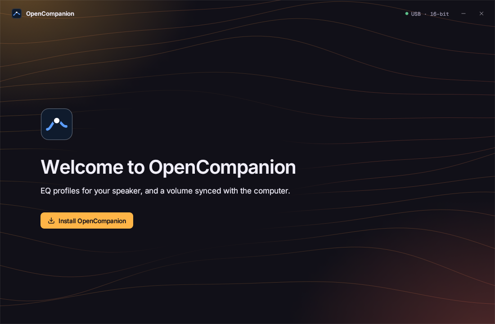
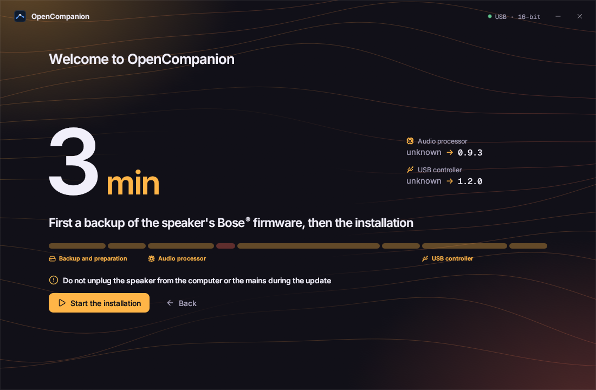

# First setup

The app installs OpenCompanion on the speaker for you, in about 3 minutes (an estimate).

## Before you start

- Speaker plugged into the **mains** and into the computer by **USB** (directly, no hub).
- A laptop stays **on its charger**.
- Turn the computer's volume and the knob **all the way down**.

## Run the guided install

1. Open OpenCompanion. If the speaker still has its Bose® firmware, the **Install OpenCompanion** wizard
   opens by itself. Otherwise: **Settings > Firmware > Open the assistant**.
2. Click **Start the installation**.
3. **Don't unplug the speaker** (USB or mains) until the app says **"OpenCompanion is installed"**.
4. If asked, unplug the speaker from the mains, then plug it back in. This starts the new USB controller firmware.

The app keeps the computer awake while it works.

## What the wizard does

1. **Download**: the latest firmware from GitHub, checked against its SHA-256 fingerprints. Offline, a firmware
   it already downloaded is used.
2. **Backup**: reads the original Bose firmware of the USB controller twice, checks both reads match, and saves
   it on your computer. Checks the audio processor's memory matches the Bose firmware and saves a copy too.
   Nothing on the speaker has changed yet.
3. **Preparation**: loads a small temporary program into the audio processor. Nothing is written.
4. **Audio processor**: installs a startup chain with a **rescue mode**, then the firmware. Every piece is read
   back. If interrupted, the speaker restarts in rescue mode and the install can resume.
   - For about 17 milliseconds the bar turns orange: **"Sensitive step: do not unplug now"**. It's the only
     moment a power cut would make the speaker unrecoverable without opening it.
5. **USB controller**: writes the firmware page by page, reads it all back, and writes the "installation
   complete" mark last. If interrupted, the chip starts in its built-in loading mode (see [recovery](recovery.md)).

## If it's interrupted

Cable unplugged, power cut…: the wizard shows **"Interrupted"** and a **Resume** button. Unplug the speaker from
the mains for 10 seconds, plug it back in, click **Resume**. What's already written is checked, not rewritten.

Still stuck? See [troubleshooting](troubleshooting.md).

## Keep your backup

The backup is what lets you [go back to Bose](restore.md). It lives in a dated folder per speaker (for example
`2026-11-01_143012`):

| System | Folder |
|---|---|
| Windows | `%APPDATA%\OpenCompanion\backups\` |
| macOS | `~/Library/Application Support/OpenCompanion/backups/` |
| Linux | `~/.local/share/opencompanion/backups/` |

- It holds `u6002_tas.bin` (USB controller) and `u7001_dsp.bin` (audio processor).
- **Don't delete it.** Keep a copy elsewhere (USB stick, online storage).
