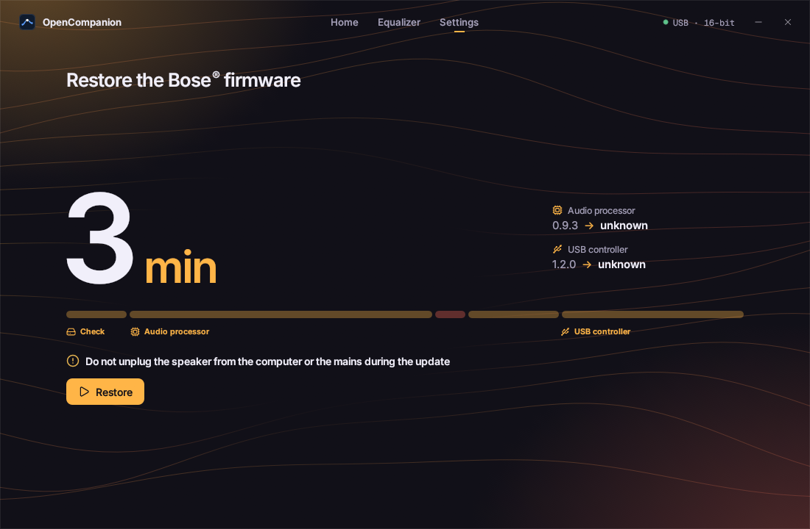
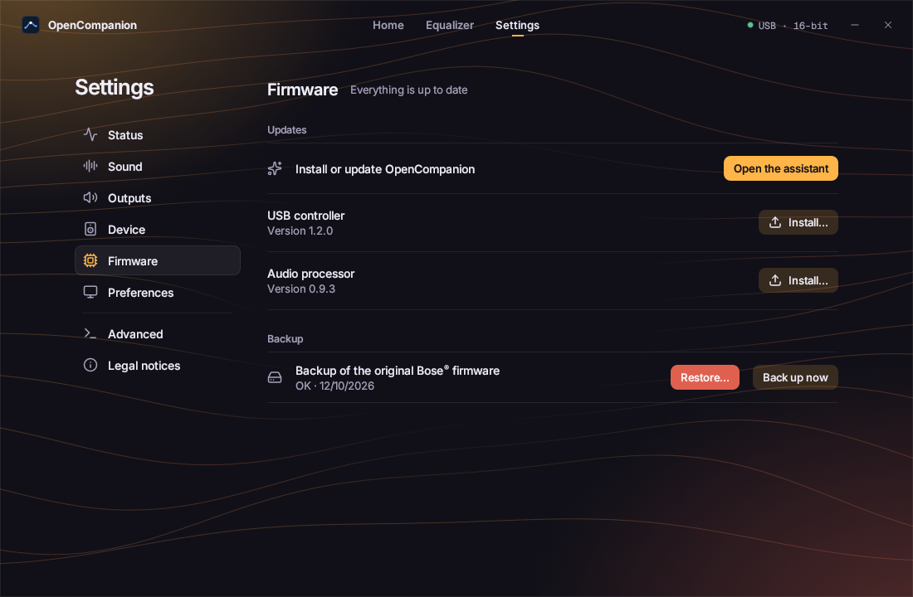

# Back to Bose

Put the original Bose® firmware back on the speaker, from the backup made at install.

## From the app

1. Go to **Settings > Firmware**.
2. On the **Backup** row, click **Restore…**.
3. Follow the **Restore the Bose firmware** wizard. It restores the audio processor, then the USB controller,
   and reads everything back.
4. Don't unplug the speaker until it's done. It may ask you to unplug the speaker from the mains and plug it
   back in.

## Good to know

- The **profiles stored in the speaker are erased**.
- **Restore…** stays greyed out while no backup is found: keep your [backup folder](first-setup.md#keep-your-backup).
- **Install interrupted early?** As long as the orange "sensitive step" wasn't passed, the speaker simply
  restarts on its Bose firmware.
- **Speaker no longer works?** Follow the [recovery guide](recovery.md).
